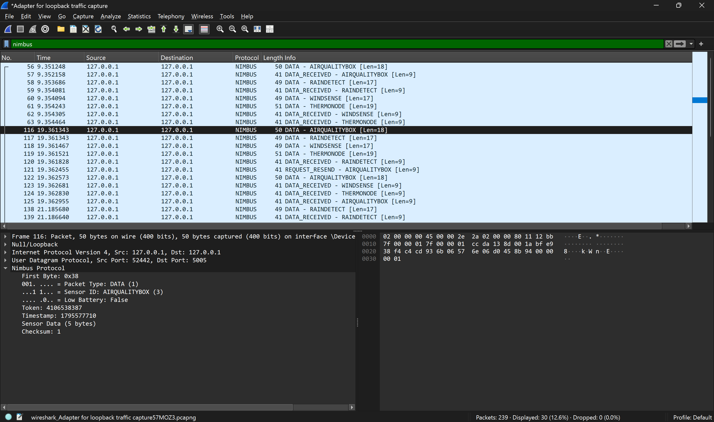

# Nimbus
IoT Weather Sensor Network Simulation

## Introduction
This repository contains a complete simulation of an IoT weather monitoring system. It features a custom UDP-based binary protocol, a multi-threaded server, a client-side sensor simulator, and a custom Wireshark dissector for network traffic analysis.

The system simulates four types of meteorological sensors transmitting telemetry data, while the server handles their registration, activity checks (heartbeats), and packet retransmissions.

Written in pure Python using only the standard library.

## Architecture
The project consists of two main Python applications and a Lua script:

1. **Server (`server.py`):** Listens on a UDP port, handles sensor registration (assigning tokens), validates checksums, processes incoming telemetry data, and detects inactive sensors, reporting them as disconnected.
2. **Tester / Simulator (`tester.py`):** Acts as the sensor network. It can automatically generate random data or send manual inputs for four sensor types. It handles ACKs, retries unacknowledged packets, and can simulate corrupted data or disconnections.
3. **Wireshark Dissector (`script.lua`):** A custom plugin for Wireshark that decodes the Nimbus packet header, token, timestamp and checksum, making it easy to follow the communication during transmission.

### Project Structure
```
server.py               server application
tester.py               sensor simulator
script.lua              Wireshark dissector
enums/                  packet types, sensor IDs, flood risk levels
sensors/                data classes for each sensor type
utils/
  binaryProtocol.py     packet encoding / decoding (header, token, timestamp, CRC)
  sensorPayload.py      bit-packing of sensor measurements
  checksum.py           CRC32
  formatData.py         server output formatting
  userInput.py          console input helpers
  manualData.py         manual entry of sensor values
  randomData.py         random sensor values
  sensorManager.py      periodic background sending for one sensor
```

## Custom Binary Protocol
The system uses a compact custom binary protocol over UDP: a whole packet takes only 9-19 bytes. Packet type, sensor ID and the low battery flag share a single header byte, and sensor values are **bit-packed** using only as many bits as their range requires.

### Packet Layout
All multi-byte fields are big-endian.

| Field     | Size     | Present in                                              |
|-----------|----------|---------------------------------------------------------|
| Header    | 1 B      | all packets                                             |
| Token     | 4 B      | `DATA`, `ACTIVITY_CONFIRMATION`, `REGISTRATION_RESPONSE` |
| Timestamp | 4 B      | all packets (UNIX time, seconds)                        |
| Payload   | 4-6 B    | `DATA` only                                             |
| Checksum  | 4 B      | all packets (CRC32 of all preceding bytes)              |

Header byte:

| Bits 7-5    | Bits 4-3  | Bit 2       | Bits 1-0 |
|-------------|-----------|-------------|----------|
| Packet type | Sensor ID | Low battery | unused   |

### Packet Types

| ID | Type                    | Direction       | Size     | Purpose                                     |
|----|-------------------------|-----------------|----------|---------------------------------------------|
| 0  | `REGISTRATION`          | sensor -> server | 9 B      | request a token                             |
| 1  | `DATA`                  | sensor -> server | 17-19 B  | measured values                             |
| 2  | `ACTIVITY_CONFIRMATION` | sensor -> server | 13 B     | reply to an activity check                  |
| 3  | `REGISTRATION_RESPONSE` | server -> sensor | 13 B     | assigned token                              |
| 4  | `DATA_RECEIVED`         | server -> sensor | 9 B      | acknowledgement (ACK) of a data packet      |
| 5  | `REQUEST_RESEND`        | server -> sensor | 9 B      | checksum failed, send the last data again   |
| 6  | `INVALID_TOKEN`         | server -> sensor | 9 B      | unknown token, the sensor must re-register  |
| 7  | `ACTIVITY_CHECK`        | server -> sensor | 9 B      | is the sensor still alive?                  |

### Supported Sensors
Each value is stored as an unsigned integer offset from its minimum and scaled by its precision (e.g. temperature -50.0...60.0 °C with 0.1 precision -> 1100 steps -> 11 bits).

| Sensor          | Parameters (range -> bits)                                                                 | Payload |
|-----------------|--------------------------------------------------------------------------------------------|---------|
| `THERMONODE`    | temperature -50.0...60.0 °C -> 11, humidity 0.0...100.0 % -> 10, dew point -50.0...60.0 °C -> 11, pressure 800.00...1100.00 hPa -> 15 | 6 B |
| `WINDSENSE`     | wind speed 0.0...50.0 m/s -> 9, wind gust 0.0...70.0 m/s -> 10, direction 0...359° -> 9, turbulence 0.0...1.0 -> 4 | 4 B |
| `RAINDETECT`    | rainfall 0.0...500.0 mm -> 13, soil moisture 0.0...100.0 % -> 10, flood risk 0...3 -> 2, rain duration 0...60 min -> 6 | 4 B |
| `AIRQUALITYBOX` | CO2 300...5000 ppm -> 13, ozone 0.0...500.0 µg/m³ -> 13, air quality index 0...500 -> 9 | 5 B |

## Key Features
- **Token-based registration:** Every sensor registers first and must include the received token in its data; unknown tokens are rejected and the sensor re-registers automatically.
- **Robust Communication:** Every data packet is acknowledged. If no ACK arrives within 1 second, the simulator resends the packet (up to 10 times). The server menu can withhold ACKs for a chosen sensor to demonstrate this.
- **Activity Monitoring:** After 15 seconds without a message the server sends `ACTIVITY_CHECK` packets every 5 seconds (up to 10 times). A check left unanswered for 1 second is reported as `DISCONNECTED`; a later reply is reported as `RECONNECTED`.
- **Error Simulation:** The tester can intentionally corrupt the checksum of the next packet to trigger the server's `REQUEST_RESEND` logic.
- **Traffic Analysis:** The included `.lua` script lets you inspect the protocol directly in Wireshark.

## How to Run

### Prerequisites
- Python 3.8+
- Wireshark (optional, for traffic analysis)

### 1. Start the Server
```bash
python server.py
```
Use the interactive menu to configure the IP/PORT (default `0.0.0.0:5005`) and start listening.

### 2. Start the Sensor Simulator
```bash
python tester.py
```
By default the simulator sends to `127.0.0.1:5005`. When the server runs on another machine, set its IP address via *Configure IP/PORT* first.

Then use the menu to start automatic data generation (every 10 seconds per sensor), send manual messages, corrupt a packet, or simulate a disconnection.

### Example Server Output
```
INFO: 0 REGISTERED at 1764867540
1764867540 - 0
temperature: 21.4; humidity: 55.5; dew_point: 12.1; pressure: 1013.25;

1764867541 - WARNING: LOW BATTERY 1
wind_speed: 4.2; wind_gust: 9.8; wind_direction: 270; turbulence: 0.3;

INFO: 1 CORRUPTED DATA at 1764867545. REQUESTING DATA
WARNING: 3 DISCONNECTED!
INFO: 3 RECONNECTED!
```

### 3. Wireshark Integration (Optional)
1. Copy `script.lua` to your Wireshark plugins folder (`Help -> About Wireshark -> Folders -> Personal Lua Plugins`).
2. Restart Wireshark.
3. Start capturing on the loopback interface (`lo` or `Adapter for loopback traffic`) and use the display filter `nimbus`.

The dissector is registered for UDP port `5005`. If you use a different port, change the last line of `script.lua` accordingly.



*Captured Nimbus traffic. The selected packet #116 is a `DATA` packet from `AIRQUALITYBOX` sent with a deliberately corrupted checksum. The server rejects it with `REQUEST_RESEND` (#121), the sensor sends the data again (#122), and the server acknowledges it with `DATA_RECEIVED` (#125).*
